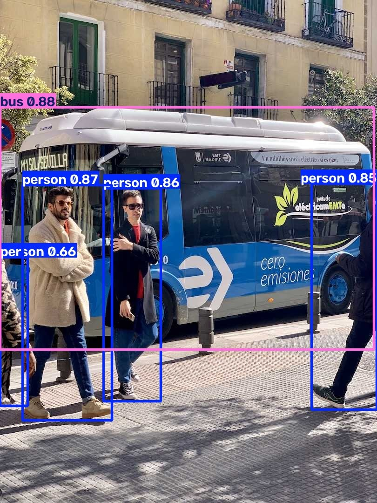
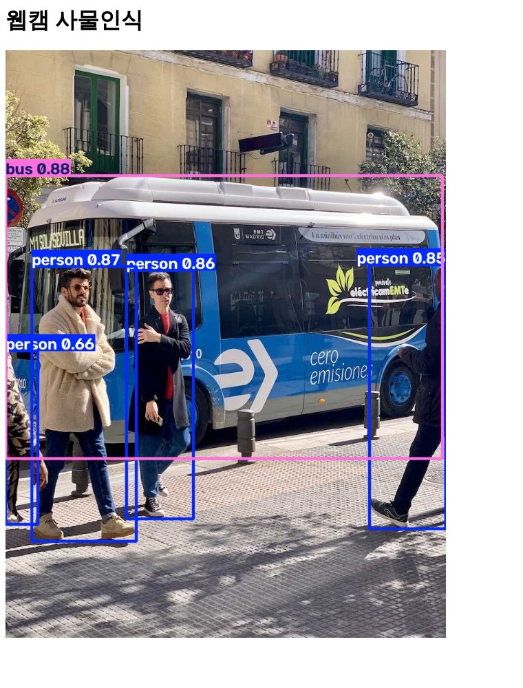
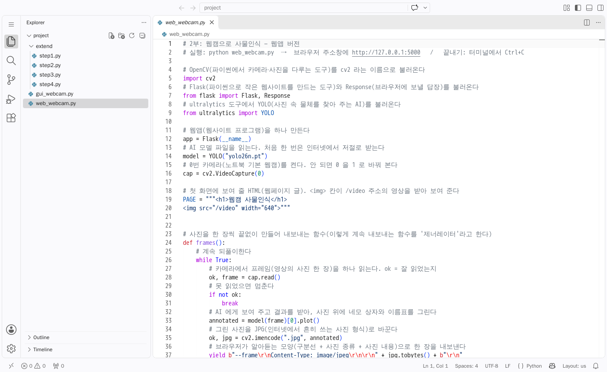

# 02. 내 컴퓨터 웹캠으로 사물인식 — GUI 창 → 웹앱

> 🎯 **대상: 비전공 · 프로그래밍 처음인 학생**
> 「이렇게 쉬운 걸?」 싶을 만큼 한 단계씩 풀어 썼습니다. 처음 하는 학생이 혼자서도 따라올 수 있게 하는 것이 목표입니다.

## 📌 #20261103 수업 안내

**지난 시간**에는 ([복습 노트](../01-코랩-YOLO-detect/README.md))
- Colab 에서 <https://colab.research.google.com/notebooks/intro.ipynb>
- 간편한 표준 에디터 마크다운에 대해서 보았고 <https://colab.research.google.com/notebooks/markdown_guide.ipynb>
- YOLO 를 이용한 사물인식을 해 봤어요 <https://colab.research.google.com/drive/1dtJG0gzXJD4R5dXePizcTcal_lXdIYS2>

**오늘은 YOLO 를 내 로컬 컴퓨터에서**
1. 가장 작은 코드(약 20줄)로 GUI 로 웹카메라를 이용해서 구현해 보고
2. 가장 작은 코드로 위와 똑같은 기능을 웹앱(Flask)으로 구현해 볼 예정
3. 우리가 가는 최종 목적지는 **웹앱**

[← 목차로](../README.md) · 다음 문서: [Copilot 으로 기능 늘리기](copilot-기능확장.md)

지난 시간에는 코랩(인터넷 속 컴퓨터)에서 YOLO 로 사진 속 물체를 찾아 봤습니다.
이번에는 **내 노트북의 웹캠**으로 똑같은 일을 실시간으로 합니다. 코드는 **VS Code + GitHub Copilot**(코드를 같이 써 주는 AI)에게 부탁해서 만듭니다.

같은 일을 두 번 만듭니다.

1. **1부 GUI** — 내 컴퓨터에 창이 하나 떠서 영상이 나옵니다.
2. **2부 웹앱** — 브라우저(크롬·엣지)에서 주소를 열면 영상이 나옵니다.

| 1부 GUI 결과 | 2부 웹앱 결과 |
|---|---|
|  |  |

> 위 두 그림은 **예시 사진(bus.jpg)으로 찍은 화면**입니다. 서버에는 웹캠이 없어서 카메라 대신 사진을 넣고 같은 코드를 돌렸습니다. 수업에서는 여러분의 **웹캠 화면**이 나옵니다.

---

## 1. 오늘 배울 것 (학습 목표)

- 내 컴퓨터에 파이썬 작업 공간(가상환경)을 만들고 필요한 도구를 깔 수 있다.
- Copilot Chat 에 우리말로 부탁해서 코드를 받아 실행할 수 있다.
- 웹캠 → AI(YOLO) → 결과 화면 으로 이어지는 흐름을 말로 설명할 수 있다.
- 같은 기능을 **창(GUI)** 과 **웹앱** 두 가지로 만들어 보고 차이를 안다.

## 2. 준비물

| 무엇 | 설명 |
|---|---|
| 노트북(웹캠 달린 것) | 웹캠이 없으면 USB 웹캠을 꽂습니다 |
| Miniconda **(추천)** | 「가상환경 상자」를 만들어 주는 작은 프로그램. [Miniconda 받기](https://www.anaconda.com/download/success) — 이게 있으면 아래 Python 은 따로 안 깔아도 됩니다 |
| (conda 가 없으면) Python 3.10 ~ 3.12 | 파이썬 프로그램. [python.org](https://www.python.org/downloads/) 에서 받습니다. 설치 첫 화면에서 **「Add python.exe to PATH」 칸을 꼭 체크**합니다 |
| VS Code | 코드를 쓰는 프로그램. [code.visualstudio.com](https://code.visualstudio.com/) |
| GitHub Copilot 확장 | VS Code 안에서 코드를 같이 써 주는 AI. GitHub 계정으로 로그인합니다(학생은 [GitHub Education](https://education.github.com/) 으로 무료) |
| Python 확장 | VS Code 왼쪽 「확장(블록 4개 모양)」에서 `Python` 검색 → 설치 |
| 인터넷 | 처음 실행 때 AI 모델 파일을 받습니다 |

## 3. 시간 계획 (50분 × 3)

> ⏱ **시간은 반 사정에 맞게 조절하세요.**

| 교시 | 시간 | 할 일 |
|---|---|---|
| 1교시 | 0~10분 | 지난 시간 돌아보기(코랩 YOLO detect) · 오늘 할 것 보여 주기 |
| | 10~35분 | 환경 설정: 폴더 만들기 · VS Code 로 열기 · 가상환경 · 도구 깔기 |
| | 35~50분 | Copilot 사용법 맛보기(채팅 열기 · 질문하기) |
| 2교시 | 0~15분 | **1부 GUI**: Copilot 에 부탁 → `gui_webcam.py` 받기 |
| | 15~35분 | 실행 · 웹캠으로 물건 비춰 보기 · 오류 해결 |
| | 35~50분 | 코드 한 줄씩 읽기(풀이 표) |
| 3교시 | 0~20분 | **2부 웹앱**: Copilot 에 부탁 → `web_webcam.py` 받기 · 브라우저로 열기 |
| | 20~30분 | GUI 와 웹앱 비교하기 |
| | 30~45분 | 도전 과제 / [Copilot 으로 기능 늘리기](copilot-기능확장.md) |
| | 45~50분 | 정리 |

---

## 4. 환경 설정 (Windows 기준, 한 단계씩)

### 4-1. 작업 폴더 만들기

1. 바탕화면에서 마우스 **오른쪽 단추** → **새로 만들기** → **폴더**.
2. 이름을 `yolo-webcam` 으로 적고 Enter.

### 4-2. VS Code 로 폴더 열기

1. VS Code 를 켭니다.
2. 위쪽 메뉴 **File(파일)** → **Open Folder(폴더 열기)** → 방금 만든 `yolo-webcam` 을 고르고 **폴더 선택**.
3. 「이 폴더의 작성자를 신뢰합니까?」가 뜨면 **Yes, I trust** 를 누릅니다.

### 4-3. 터미널 열기

터미널 = 글자로 컴퓨터에게 명령하는 창입니다.

- VS Code 위쪽 메뉴 **Terminal(터미널)** → **New Terminal(새 터미널)**. (단축키 `` Ctrl + ` `` — 숫자 1 왼쪽 키)
- 아래쪽에 `PS C:\Users\...\yolo-webcam>` 같은 줄이 보이면 성공입니다.

### 4-4. 가상환경 만들고 켜기

가상환경 = 이 수업용 도구만 따로 담아 두는 **작은 상자**입니다. 다른 수업 도구와 섞이지 않습니다.

> ⚠ **왜 꼭 상자를 만드나요?** 상자 없이 `pip install` 하면 도구가 컴퓨터 전체에 깔려, 다른 수업·프로그램의 도구와 판이 섞이고 꼬입니다(「어제는 됐는데 오늘은 안 돼요」의 흔한 원인). 상자 안에 깔면 **이 수업 것만** 따로 있고, 필요 없어지면 상자째 지우면 깨끗해집니다.
두 방법 중 **하나만** 하면 됩니다. **Miniconda** 가 깔려 있으면 **방법 A** 를 씁니다.

> 💡 우리 수업 약속: **conda 는 상자 만들기에만** 쓰고, 도구 깔기는 전부 **`pip install`** 로 합니다(`conda install` 은 쓰지 않습니다).

#### 방법 A — Miniconda 로 상자 만들기 (추천)

1. 시작 메뉴에서 **Anaconda Prompt (miniconda3)** 를 엽니다(VS Code 터미널에서 `conda` 가 안 먹으면 이쪽에서 합니다).
2. 한 줄씩 적고 Enter 를 누릅니다.

```bat
:: yolo 라는 이름의 상자를 파이썬 3.11 로 만든다 (중간에 Proceed ([y]/n)? 가 나오면 y)
conda create -n yolo python=3.11
:: 그 상자 안으로 들어간다
conda activate yolo
:: 오늘 쓸 도구를 상자 안에 pip 로 깐다
pip install ultralytics opencv-python flask
```

- 줄 맨 앞이 `(base)` 에서 `(yolo)` 로 바뀌면 상자 안에 들어온 것입니다.
- **VS Code 에서 이 상자 쓰기**: `Ctrl + Shift + P` → `Python: Select Interpreter` → 목록에서 **`yolo` (conda)** 를 고릅니다. 오른쪽 아래 상태 줄에 `yolo` 가 보이면 됩니다.
- VS Code 터미널에서 `conda` 를 모른다고 나오면 Anaconda Prompt (miniconda3) 에서 `conda init` 를 한 번 하고 VS Code 를 다시 엽니다.
- 다음 시간에 다시 할 때는 만들기 없이 `conda activate yolo` 만 하면 됩니다.
- 다 쓰고 지우고 싶으면 `conda deactivate` → `conda env remove -n yolo` — 컴퓨터는 깔기 전 그대로입니다.
- 방법 A 로 했으면 아래 4-5 는 이미 끝난 것입니다(위 `pip install` 줄). 바로 **4-6** 으로 갑니다.

#### 방법 B — venv (Miniconda 가 없을 때)

파이썬만 깔려 있으면 됩니다. 터미널에 한 줄씩 적고 Enter 를 누릅니다.

```powershell
python -m venv venv
venv\Scripts\activate
```

- 줄 맨 앞에 `(venv)` 가 붙으면 상자 안에 들어온 것입니다.
- 「스크립트를 실행할 수 없습니다」 빨간 글씨가 나오면 아래를 한 번 적고 다시 `venv\Scripts\activate` 합니다.
  ```powershell
  Set-ExecutionPolicy -Scope CurrentUser RemoteSigned
  ```
- VS Code 오른쪽 아래에 「가상환경을 쓸까요?」가 뜨면 **Yes**.

### 4-5. 도구 깔기

```powershell
pip install ultralytics opencv-python
```

- `ultralytics` = YOLO AI 도구, `opencv-python` = 카메라·사진 도구.
- 2부 웹앱 때는 하나 더 깝니다.
  ```powershell
  pip install flask
  ```
- 한 번에 깔려면 이 폴더의 [requirements.txt](requirements.txt) 를 받아 두고 `pip install -r requirements.txt`.
- 몇 분 걸립니다. 마지막에 `Successfully installed …` 가 보이면 끝입니다.

> 🍎 **macOS**: 터미널에서 `python3 -m venv venv` → `source venv/bin/activate` → 나머지는 같습니다(처음 실행 때 카메라 허용 창이 뜨면 「허용」).

### 4-6. VS Code 에서 파이썬 파일 만들고 실행하는 법

1. 왼쪽 **탐색기(종이 두 장 모양)** 에서 폴더 이름 옆 **새 파일** 아이콘 → 이름 `gui_webcam.py` → Enter.
2. 코드를 붙여 넣고 **Ctrl + S** 로 저장.
3. 실행: 오른쪽 위 **▶ (Run Python File)** 단추를 누르거나, 터미널에 `python gui_webcam.py` 를 적고 Enter.
4. 끝낼 때: GUI 는 창을 한 번 누르고 **q** 키, 웹앱은 터미널을 누르고 **Ctrl + C**.



> 위 그림은 VS Code 웹판(code-server)으로 찍은 화면입니다. 여러분 PC 의 VS Code 도 거의 같은 모양입니다.

---

## 5. Copilot Chat 쓰는 법 (아주 짧게)

1. **Ctrl + Alt + I** 를 누르면 오른쪽에 **Chat(채팅)** 창이 열립니다. (또는 위쪽 가운데 Copilot 아이콘)
2. 아래 칸에 우리말로 부탁을 적고 Enter.
3. Copilot 이 준 코드 위에 마우스를 올리면 나오는 **복사(Copy)** 단추로 복사해 내 파일에 붙여 넣습니다.
4. 모르는 줄이 있으면 그 줄을 마우스로 골라 놓고 Chat 에 「**이 줄 설명해 줘. 나는 프로그래밍 처음이야**」라고 묻습니다.

> ⚠ Copilot 은 매번 조금씩 다른 코드를 줍니다. 아래 **정답 코드**와 다르면 정답 코드를 쓰세요. 이 수업에서는 모델 이름을 `yolo26n.pt` 로 맞춥니다.

더 자세한 사용법(파일을 `#` 으로 참조하기, Edit/Agent 모드)은 [Copilot 으로 기능 늘리기](copilot-기능확장.md) 앞부분에 있습니다.

---

## 6. 1부 — GUI(창)로 웹캠 사물인식

### 6-1. Copilot Chat 에 붙여 넣을 부탁(프롬프트)

```text
나는 프로그래밍을 처음 배우는 학생이야.
파이썬으로 노트북 웹캠 영상을 읽어서 YOLO 로 사물인식을 하고,
결과를 OpenCV 창(cv2.imshow)에 띄우는 아주 짧은 코드를 만들어 줘.
- ultralytics 의 YOLO("yolo26n.pt") 를 써 줘
- 상자 그리기는 results[0].plot() 으로 해 줘
- q 키를 누르면 끝나게 해 줘
- 20줄 정도로 최소한으로, 모든 줄 바로 윗줄에 쉬운 한국어 주석을 달아 줘
파일 이름은 gui_webcam.py 야.
```

### 6-2. 정답 코드 — [gui_webcam.py](gui_webcam.py)

```python
# 1부: 웹캠으로 사물인식 — GUI(창) 버전
# 실행: python gui_webcam.py   /   끝내기: 창을 누른 뒤 q 키

# OpenCV(파이썬에서 카메라·사진을 다루는 도구)를 cv2 라는 이름으로 불러온다
import cv2
# ultralytics 도구에서 YOLO(사진 속 물체를 찾아 주는 AI)를 불러온다
from ultralytics import YOLO

# AI 모델 파일을 읽는다. 처음 한 번은 인터넷에서 저절로 받는다(n = 가장 작고 빠른 것)
model = YOLO("yolo26n.pt")
# 0번 카메라(노트북 기본 웹캠)를 켠다. 안 되면 0 을 1 로 바꿔 본다
cap = cv2.VideoCapture(0)

# 카메라가 켜져 있는 동안 계속 되풀이한다
while cap.isOpened():
    # 카메라에서 프레임(영상의 사진 한 장)을 하나 읽는다. ok = 잘 읽었는지(참/거짓)
    ok, frame = cap.read()
    # 못 읽었으면(카메라가 꺼졌으면) 되풀이를 멈춘다
    if not ok:
        break
    # 사진 한 장을 AI 에게 보여 주고 무엇이 어디 있는지 결과를 받는다
    results = model(frame)
    # 결과를 사진 위에 네모 상자와 이름표로 그린다
    annotated = results[0].plot()
    # 그린 사진을 "YOLO" 라는 이름의 창에 띄운다
    cv2.imshow("YOLO", annotated)
    # 1밀리초 동안 키보드를 보고, q 키가 눌렸으면 멈춘다
    if cv2.waitKey(1) & 0xFF == ord("q"):
        break

# 카메라를 끈다(다른 프로그램이 쓸 수 있게 돌려준다)
cap.release()
# 열려 있는 창을 모두 닫는다
cv2.destroyAllWindows()
```

### 6-3. 한 줄씩 풀이

- `import cv2`  
  → 카메라·사진 도구(OpenCV)를 꺼내 온다
- `from ultralytics import YOLO`  
  → 물체 찾는 AI(YOLO)를 꺼내 온다
- `model = YOLO("yolo26n.pt")`  
  → AI 의 「뇌」 파일을 읽는다. 처음엔 인터넷에서 받아 온다(약 5MB)
- `cap = cv2.VideoCapture(0)`  
  → 0번 카메라를 켠다. `cap` 은 카메라를 부르는 이름
- `while cap.isOpened():`  
  → 카메라가 켜져 있는 동안 아래를 **계속 되풀이**
- `ok, frame = cap.read()`  
  → 사진 한 장(프레임)을 찍어 `frame` 에 담는다
- `if not ok: break`  
  → 못 찍었으면 되풀이를 그만둔다
- `results = model(frame)`  
  → AI 에게 사진을 보여 주고 답을 받는다
- `annotated = results[0].plot()`  
  → 답을 사진 위에 상자·이름·숫자로 그린다
- `cv2.imshow("YOLO", annotated)`  
  → 그린 사진을 창에 보여 준다. 빨리 되풀이하니 **영상처럼** 보인다
- `cv2.waitKey(1) … ord("q")`  
  → q 키를 눌렀는지 본다. 눌렀으면 그만
- `cap.release()` / `cv2.destroyAllWindows()`  
  → 카메라를 끄고 창을 닫는다(뒷정리)

> 💡 상자 옆 숫자(예: `person 0.87`)는 **신뢰도** — AI 가 「87% 정도 사람이 맞다」고 믿는다는 뜻입니다.

---

## 7. 2부 — 똑같은 것을 웹앱으로

**왜 웹앱?** 창(GUI)은 내 컴퓨터에서만 보입니다. 웹앱은 **브라우저**로 보니까, 나중에 휴대폰이나 다른 사람 컴퓨터에서도 볼 수 있게 키워 갈 수 있습니다. 앞으로 결과물은 웹앱으로 만듭니다.

흐름은 같고, 마지막 「창에 띄우기」만 「브라우저로 보내기」로 바뀝니다.

```
웹캠 → 사진 한 장 → YOLO → 상자 그리기 → (1부) 창에 띄우기
                                       → (2부) JPG 로 바꿔 브라우저로 계속 보내기
```

### 7-1. 먼저 Flask 깔기

```powershell
pip install flask
```

### 7-2. Copilot Chat 에 붙여 넣을 부탁(프롬프트)

```text
#gui_webcam.py 를 웹앱으로 바꾸고 싶어. 나는 프로그래밍 처음이야.
Flask 로 아주 짧은 웹앱을 만들어 줘. 파일 이름은 web_webcam.py 야.
- 서버가 노트북 웹캠을 읽고 YOLO("yolo26n.pt") 로 사물인식해서 results[0].plot() 으로 상자를 그려 줘
- 그 사진들을 MJPEG(multipart/x-mixed-replace) 로 /video 주소에 계속 보내 줘
- 첫 화면(/)은 HTML 을 파일 안에 짧은 문자열로 넣고,  로 영상을 보여 줘
- http://127.0.0.1:5000 으로 열리게 해 줘
- 40줄 정도로 최소한으로, 모든 줄 바로 윗줄에 쉬운 한국어 주석을 달아 줘
```

> `#gui_webcam.py` 처럼 `#` 뒤에 파일 이름을 적으면 Copilot 이 그 파일을 보고 답합니다.

### 7-3. 정답 코드 — [web_webcam.py](web_webcam.py)

```python
# 2부: 웹캠으로 사물인식 — 웹앱 버전
# 실행: python web_webcam.py  →  브라우저 주소창에 http://127.0.0.1:5000   /   끝내기: 터미널에서 Ctrl+C

# OpenCV(파이썬에서 카메라·사진을 다루는 도구)를 cv2 라는 이름으로 불러온다
import cv2
# Flask(파이썬으로 작은 웹사이트를 만드는 도구)와 Response(브라우저에 보낼 답장)를 불러온다
from flask import Flask, Response
# ultralytics 도구에서 YOLO(사진 속 물체를 찾아 주는 AI)를 불러온다
from ultralytics import YOLO

# 웹앱(웹사이트 프로그램)을 하나 만든다
app = Flask(__name__)
# AI 모델 파일을 읽는다. 처음 한 번은 인터넷에서 저절로 받는다
model = YOLO("yolo26n.pt")
# 0번 카메라(노트북 기본 웹캠)를 켠다. 안 되면 0 을 1 로 바꿔 본다
cap = cv2.VideoCapture(0)

# 첫 화면에 보여 줄 HTML(웹페이지 글).  칸이 /video 주소의 영상을 받아 보여 준다
PAGE = """<h1>웹캠 사물인식</h1>
"""


# 사진을 한 장씩 끝없이 만들어 내보내는 함수(이렇게 계속 내보내는 함수를 '제너레이터'라고 한다)
def frames():
    # 계속 되풀이한다
    while True:
        # 카메라에서 프레임(영상의 사진 한 장)을 하나 읽는다. ok = 잘 읽었는지
        ok, frame = cap.read()
        # 못 읽었으면 멈춘다
        if not ok:
            break
        # AI 에게 보여 주고 결과를 받아, 사진 위에 네모 상자와 이름표를 그린다
        annotated = model(frame)[0].plot()
        # 그린 사진을 JPG(인터넷에서 흔히 쓰는 사진 형식)로 바꾼다
        ok, jpg = cv2.imencode(".jpg", annotated)
        # 브라우저가 알아듣는 모양(구분선 + 사진 종류 + 사진 내용)으로 한 장을 내보낸다
        yield b"--frame\r\nContent-Type: image/jpeg\r\n\r\n" + jpg.tobytes() + b"\r\n"


# 누군가 첫 화면(/) 주소로 들어오면 아래 함수를 실행한다
@app.route("/")
# 첫 화면 함수
def index():
    # 위에서 만든 웹페이지 글을 돌려준다
    return PAGE


# 누군가 /video 주소로 들어오면 아래 함수를 실행한다
@app.route("/video")
# 영상 함수
def video():
    # 사진을 줄줄이 이어 보내 영상처럼 보이게 한다(MJPEG = 사진을 이어 붙인 영상)
    return Response(frames(), mimetype="multipart/x-mixed-replace; boundary=frame")


# 이 파일을 직접 실행했을 때만 웹앱을 켠다
if __name__ == "__main__":
    # 내 컴퓨터(127.0.0.1)의 5000번 문으로 웹앱을 켠다
    app.run(host="127.0.0.1", port=5000)
```

### 7-4. 한 줄씩 풀이 (1부와 다른 곳만)

- `app = Flask(__name__)`  
  → 작은 웹사이트(웹앱)를 하나 만든다
- `PAGE = """…"""`  
  → 첫 화면 글. `` 는 「/video 주소에서 그림을 받아 와 보여 줘」라는 뜻
- `def frames():`  
  → 사진을 끝없이 만들어 내는 함수
- `cv2.imencode(".jpg", …)`  
  → 사진을 JPG 파일 모양으로 바꾼다(브라우저는 JPG 를 알아본다)
- `yield …`  
  → 사진 한 장을 내보내고, 다음 사진을 만들러 다시 위로 간다
- `@app.route("/")`  
  → 「첫 화면 주소로 오면 아래 함수를 실행해」라는 표시
- `@app.route("/video")`  
  → 「/video 주소로 오면 아래 함수를 실행해」
- `Response(…, mimetype="multipart/x-mixed-replace…")`  
  → 사진을 **갈아 끼우며 계속** 보내라는 뜻. 브라우저는 이걸 영상처럼 보여 준다(MJPEG)
- `app.run(host="127.0.0.1", port=5000)`  
  → 내 컴퓨터의 5000번 문으로 웹앱을 켠다

### 7-5. 실행하고 보기

1. 터미널에 `python web_webcam.py` → Enter.
2. `Running on http://127.0.0.1:5000` 이 보이면, 브라우저 주소창에 `http://127.0.0.1:5000` 을 적고 Enter.
3. 웹캠 영상에 상자가 그려져 나오면 성공입니다.


> 예시 사진으로 찍은 화면 — 수업에서는 웹캠 화면이 나옵니다.

### 7-6. GUI 와 웹앱 비교

| | 1부 GUI | 2부 웹앱 |
|---|---|---|
| 보는 곳 | 컴퓨터에 뜨는 창 | 브라우저 |
| 끝내기 | 창에서 q | 터미널에서 Ctrl + C |
| 바뀐 코드 | `cv2.imshow` | `imencode` + `yield` + Flask 주소 2개 |
| 앞으로 | 연습용 | 단추·슬라이더를 붙여 키워 간다 → [Copilot 으로 기능 늘리기](copilot-기능확장.md) |

---

## 8. 자주 나는 오류와 해결

| 증상 | 이유 | 해결 |
|---|---|---|
| 화면이 까맣거나 `ok` 가 거짓 | 카메라 번호가 다름(USB 웹캠은 1번일 때가 많음) | `cv2.VideoCapture(0)` 의 0 을 **1** 로 바꿔 본다 |
| 카메라가 안 켜짐 | Windows 가 카메라를 막아 둠 | **설정 → 개인 정보 및 보안 → 카메라** 에서 「카메라 액세스」와 「데스크톱 앱이 카메라에 액세스하도록 허용」을 켠다. 줌·팀즈 등 카메라 쓰는 프로그램은 끈다 |
| macOS 에서 카메라가 안 켜짐 | 터미널/VS Code 에 카메라 권한이 없음 | **시스템 설정 → 개인정보 보호 및 보안 → 카메라** 에서 VS Code(또는 터미널)를 켜고 VS Code 를 다시 연다 |
| `cv2.imshow` 창이 안 뜸 / `The function is not implemented` | `opencv-python-headless`(창 없는 판)가 깔려 있음 | `pip uninstall opencv-python-headless opencv-python` → `pip install opencv-python` |
| 창이 떴는데 q 가 안 먹음 | 창이 아니라 다른 곳이 눌린 상태 | 영상 창을 한 번 클릭하고 q |
| 첫 실행 때 오래 멈춘 것 같음 | AI 모델 파일(`yolo26n.pt`)을 받는 중 | 인터넷 연결을 확인하고 기다린다. 한 번 받으면 다음부터는 바로 켜진다 |
| `ModuleNotFoundError: No module named 'cv2'`(또는 ultralytics, flask) | 가상환경 밖에서 실행했거나 안 깔림 | 줄 앞에 `(yolo)`(conda) 또는 `(venv)` 가 있는지 보고, 없으면 `conda activate yolo`(또는 `venv\Scripts\activate`) 후 `pip install …`. VS Code 오른쪽 아래 인터프리터가 그 상자인지도 확인 |
| 영상이 뚝뚝 끊김(느림) | 노트북이 AI 계산을 버거워함 | 가장 작은 모델 `yolo26n.pt` 를 쓰고, `model(frame, imgsz=320)` 처럼 **사진 크기를 줄인다** |
| 웹앱 주소가 안 열림 | 프로그램이 꺼졌거나 주소를 잘못 적음 | 터미널에 `Running on http://127.0.0.1:5000` 이 있는지 보고 주소를 그대로 적는다 |
| `Address already in use` | 앞서 켠 웹앱이 아직 켜져 있음 | 그 터미널에서 Ctrl + C 로 끄거나 `port=5001` 로 바꾼다 |

---

## 9. 도전 과제 (짧게)

1. **사람 수 세기** — 화면에 사람이 몇 명인지 글자로 띄워 보세요. 힌트: `results[0].boxes.cls.tolist().count(0)` (0번 = 사람)
2. **특정 물체만 보기** — 컵만 찾게 해 보세요. 힌트: `model(frame, classes=[41])` (41번 = 컵, 67번 = 휴대폰)
3. **신뢰도 조절** — 확실한 것만 그리게 해 보세요. 힌트: `model(frame, conf=0.6)`

막히면 Copilot Chat 에 「#web_webcam.py 에서 사람 수를 화면에 보여 주게 고쳐 줘」처럼 부탁하세요.
웹앱에 슬라이더·단추로 붙이는 방법은 [Copilot 으로 기능 늘리기](copilot-기능확장.md) 에 단계별로 있습니다.

---

## 10. 정리

- 웹캠 → 사진 한 장 → YOLO → 상자 그리기 → 보여 주기. 이 흐름을 **빠르게 되풀이**하면 실시간 사물인식이 됩니다.
- 같은 흐름을 창(GUI)으로 한 번, 웹앱으로 한 번 만들었습니다.
- **앞으로는 결과물을 웹앱으로 만듭니다.**
