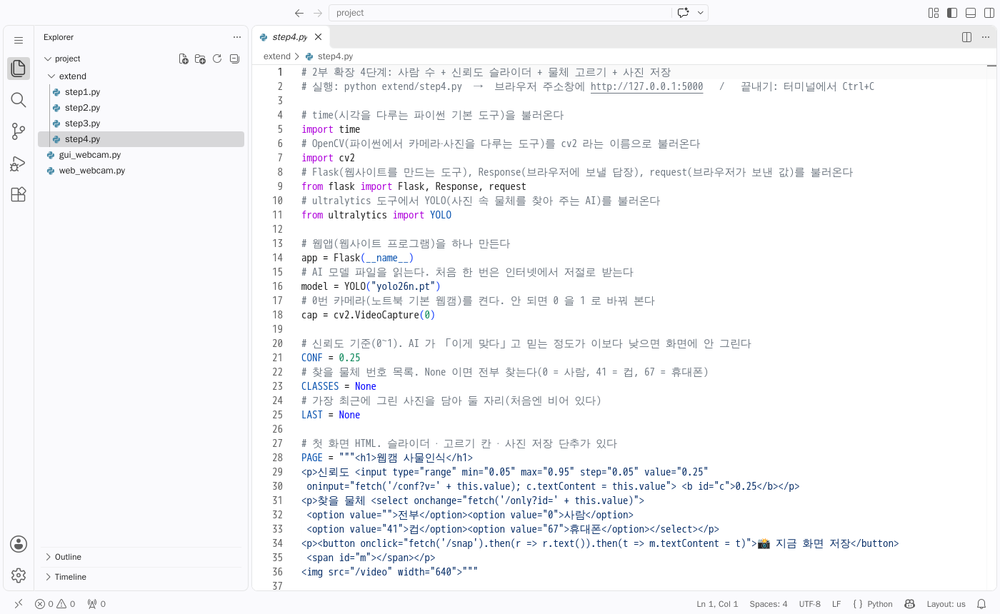
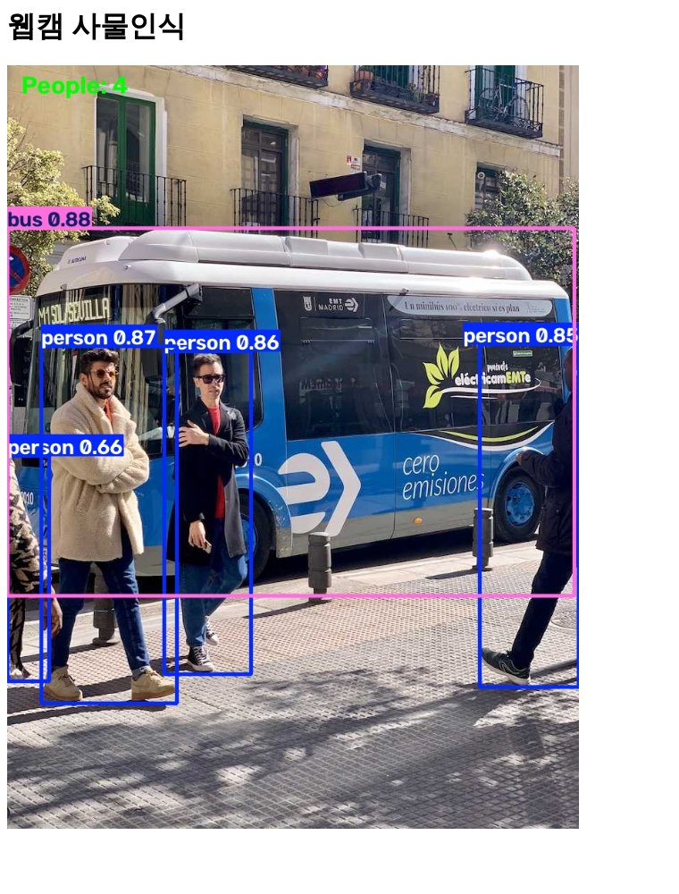
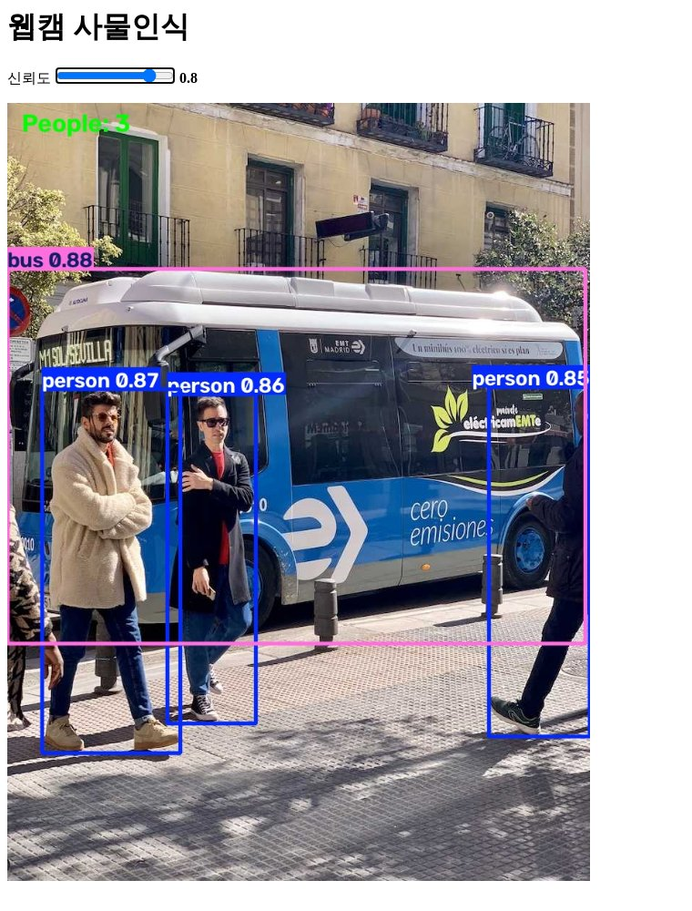
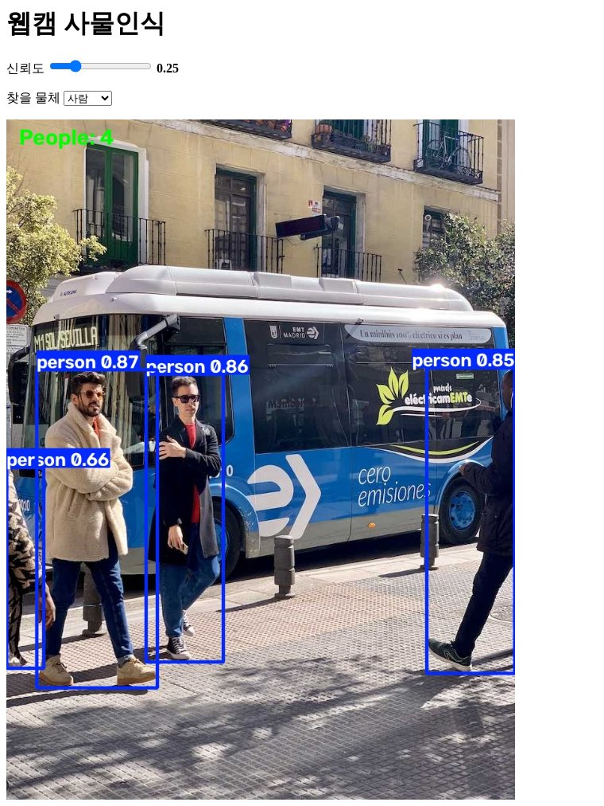
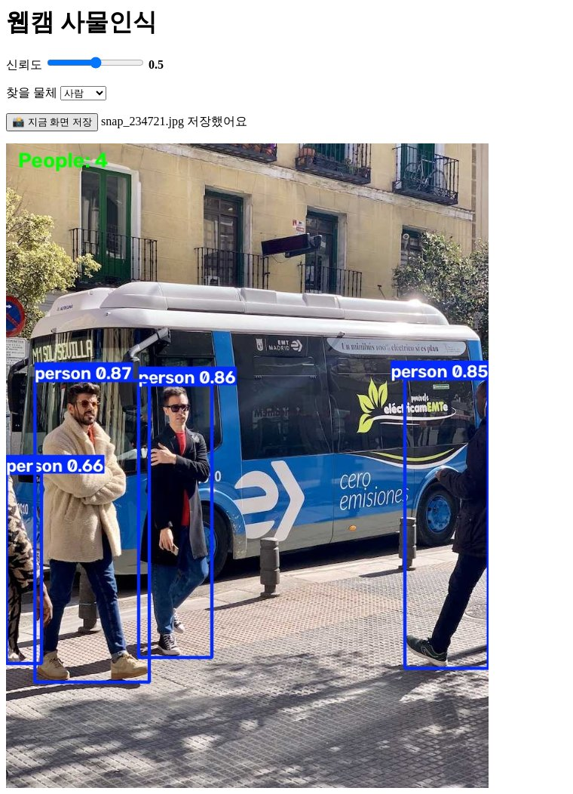

# Copilot 으로 웹앱 기능 늘리기

> 🎯 **대상: 비전공 · 프로그래밍 처음인 학생**
> 코드를 직접 다 쓰지 않아도 됩니다. **Copilot 에게 우리말로 부탁하고, 바뀐 곳을 읽고, 실행해서 확인**하는 연습입니다.

[← 목차로](../README.md) · [← 02 수업 계획](README.md)

2부에서 만든 [web_webcam.py](web_webcam.py) 에 기능을 한 단계씩 붙입니다.

| 단계 | 붙일 기능 | 정답 코드 |
|---|---|---|
| ① | 화면에 사람 수 표시 | [extend/step1.py](extend/step1.py) |
| ② | 신뢰도 슬라이더 | [extend/step2.py](extend/step2.py) |
| ③ | 찾을 물체 고르기 | [extend/step3.py](extend/step3.py) |
| ④ | 지금 화면 사진 저장 단추 | [extend/step4.py](extend/step4.py) |

각 단계는 앞 단계 위에 쌓입니다. 막히면 그 단계 정답 코드를 열어 보세요.

---

## 0. Copilot 쓰는 법

### 0-1. Chat 열기

- **Ctrl + Alt + I** (macOS 는 **⌃ + ⌘ + I**) → 오른쪽에 **Chat** 창이 열립니다.
- 처음이면 GitHub 계정으로 로그인하라는 안내가 나옵니다. 따라서 로그인합니다.

> 📸 **교수아빠 PC 에서 캡처해 넣을 자리**: VS Code 오른쪽에 Copilot Chat 창이 열린 모습(빈 입력칸이 보이게)

### 0-2. 파일을 `#` 으로 알려 주기

- 입력칸에 `#` 를 치면 파일 목록이 뜹니다. `#web_webcam.py` 를 고르면 Copilot 이 **그 파일을 읽고** 답합니다.
- 파일을 편집기에 열어 두기만 해도 대개 알아서 봅니다. 그래도 `#파일이름` 을 적어 주는 게 확실합니다.

> 📸 **교수아빠 PC 에서 캡처해 넣을 자리**: 입력칸에 `#` 를 쳐서 파일 목록이 뜬 모습

### 0-3. 고치게 하기 — 모드 고르기

입력칸 아래에 **모드**를 고르는 칸이 있습니다(VS Code 버전에 따라 이름이 조금 다릅니다).

| 모드 | 하는 일 | 언제 |
|---|---|---|
| **Ask** | 대답만 한다. 파일은 안 바꾼다 | 「이 줄 무슨 뜻이야?」 |
| **Edit** | 내가 알려 준 파일을 직접 고친다 | 이 문서의 ①~④ 처럼 한 파일 고칠 때 **(추천)** |
| **Agent** | 스스로 여러 파일을 보고 고치고, 터미널 명령도 제안한다 | 일이 클 때. 명령 실행은 묻고 하니 읽고 허락한다 |

> 최근 VS Code 에서는 Edit 이 Agent 에 합쳐져 **Ask / Agent** 만 보일 수 있습니다. 그때는 Agent 를 고르면 됩니다.

> 📸 **교수아빠 PC 에서 캡처해 넣을 자리**: 입력칸 아래 모드 고르기를 펼친 모습(Ask / Edit / Agent)

### 0-4. 고친 것 받아들이기 / 되돌리기

- Copilot 이 파일을 고치면 편집기에 **초록(더한 줄)·빨강(뺀 줄)** 으로 표시됩니다.
- 마음에 들면 **Keep(유지)**, 아니면 **Undo(실행 취소)** 를 누릅니다.
- 실수로 받아들였으면 **Ctrl + Z** 로 되돌리거나, 이 폴더의 정답 코드로 덮어씁니다.

> 📸 **교수아빠 PC 에서 캡처해 넣을 자리**: Copilot 이 고친 줄이 초록·빨강으로 보이고 Keep / Undo 단추가 보이는 모습

### 0-5. 모르면 물어보기

- 모르는 줄을 마우스로 골라 놓고(드래그) Chat 에
  **「이 줄 설명해 줘. 나는 프로그래밍 처음이야」** 라고 묻습니다.
- 오류가 나면 터미널의 빨간 글씨를 통째로 복사해 붙이고 **「이 오류 왜 나? 쉽게 알려 줘」**.

### 0-6. 이 문서의 코드 읽는 법

아래 「바뀐 곳」은 **diff** 모양입니다.

- 줄 맨 앞 `+` = 새로 **더한** 줄 · `-` = **뺀** 줄 · 아무것도 없으면 그대로인 줄 · `…` = 길어서 줄여 쓴 곳.
- 실제 파일에 붙일 때는 맨 앞 `+` 기호는 빼야 합니다. 헷갈리면 정답 코드(`extend/stepN.py`)를 통째로 쓰세요.

### 0-7. 실행하는 법(모든 단계 같음)

1. 앞에 켜 둔 웹앱이 있으면 그 터미널에서 **Ctrl + C** 로 끈다.
2. 터미널에 `python web_webcam.py` (정답 코드로 해 보려면 `python extend/step1.py` 처럼) → Enter.
3. 브라우저에서 `http://127.0.0.1:5000` 을 열거나, 이미 열려 있으면 **F5(새로 고침)**.



> 위 그림은 VS Code 웹판(code-server)으로 찍은 화면입니다. 여러분 PC 의 VS Code 도 거의 같은 모양입니다.

---

## ① 화면에 사람 수 표시

### Copilot Chat 에 붙여 넣을 부탁 (Edit 모드)

```text
#web_webcam.py 를 고쳐 줘. 나는 프로그래밍 처음이야.
영상 왼쪽 위에 지금 보이는 사람 수를 "People: 3" 처럼 초록 글씨로 써 줘.
사람은 YOLO 의 0번 물체야. 코드는 최소한으로 바꾸고, 더한 줄마다 바로 윗줄에 쉬운 한국어 주석을 달아 줘.
```

### Copilot 이 고칠 곳 (바뀐 부분만)

`frames()` 함수 안, AI 결과를 받는 곳이 바뀝니다.

```diff
-        # AI 에게 보여 주고 결과를 받아, 사진 위에 네모 상자와 이름표를 그린다
-        annotated = model(frame)[0].plot()
+        # AI 에게 보여 주고 첫 번째 결과를 받는다
+        result = model(frame)[0]
+        # 결과를 사진 위에 네모 상자와 이름표로 그린다
+        annotated = result.plot()
+        # 결과 안의 물체 번호 목록에서 0번(사람)이 몇 개인지 센다
+        people = result.boxes.cls.tolist().count(0)
+        # 사진 왼쪽 위(20, 40 자리)에 사람 수를 초록 글씨로 쓴다(영어만 된다)
+        cv2.putText(annotated, f"People: {people}", (20, 40), cv2.FONT_HERSHEY_SIMPLEX, 1.2, (0, 255, 0), 3)
```

- 한 줄로 하던 일을 `result` 로 나눈 것은, 결과를 **그리기에도 쓰고 세기에도** 쓰려고 그렇습니다.
- `cv2.putText` 는 한글을 못 씁니다(글자가 ??? 로 나옵니다). 그래서 `People` 이라고 영어로 씁니다.
- `(0, 255, 0)` 은 색깔입니다. OpenCV 는 **파랑, 초록, 빨강** 순서라서 초록입니다.

### 확인

사람이 화면에 들어오면 왼쪽 위 숫자가 바뀌는지 봅니다. 친구가 한 명 더 들어와 보세요.



> 예시 사진으로 찍은 화면 — 수업에서는 웹캠 화면이 나옵니다.

---

## ② 신뢰도 슬라이더

신뢰도 = AI 가 「이게 맞다」고 믿는 정도(0~1). 슬라이더로 **기준을 올리면 확실한 것만** 그립니다.

### Copilot Chat 에 붙여 넣을 부탁 (Edit 모드)

```text
#web_webcam.py 에 신뢰도 슬라이더를 붙여 줘. 나는 프로그래밍 처음이야.
- 첫 화면 HTML 에 0.05~0.95 슬라이더를 넣고, 움직이면 fetch 로 /conf?v=값 을 보내 줘. 옆에 지금 값을 보여 줘
- 서버는 CONF 라는 변수에 값을 저장하고, model(frame, conf=CONF) 로 써 줘
- 코드는 최소한으로, 더한 줄마다 바로 윗줄에 쉬운 한국어 주석을 달아 줘
```

### Copilot 이 고칠 곳 (바뀐 부분만)

```diff
-# Flask(파이썬으로 작은 웹사이트를 만드는 도구)와 Response(브라우저에 보낼 답장)를 불러온다
-from flask import Flask, Response
+# Flask(웹사이트를 만드는 도구), Response(브라우저에 보낼 답장), request(브라우저가 보낸 값)를 불러온다
+from flask import Flask, Response, request
```

```diff
+# 신뢰도 기준(0~1). AI 가 「이게 맞다」고 믿는 정도가 이보다 낮으면 화면에 안 그린다
+CONF = 0.25
+
-# 첫 화면에 보여 줄 HTML(웹페이지 글).  칸이 /video 주소의 영상을 받아 보여 준다
+# 첫 화면 HTML. 슬라이더(좌우로 미는 막대)를 움직이면 /conf 주소로 값을 보낸다
 PAGE = """<h1>웹캠 사물인식</h1>
+<p>신뢰도 <input type="range" min="0.05" max="0.95" step="0.05" value="0.25"
+ oninput="fetch('/conf?v=' + this.value); c.textContent = this.value"> <b id="c">0.25</b></p>
 """
```

```diff
-        # AI 에게 보여 주고 첫 번째 결과를 받는다
-        result = model(frame)[0]
+        # AI 에게 보여 주되, 신뢰도가 CONF 보다 낮은 것은 버리고 결과를 받는다
+        result = model(frame, conf=CONF)[0]
```

```diff
+# 누군가 /conf 주소로 값을 보내면 아래 함수를 실행한다
+@app.route("/conf")
+# 신뢰도 바꾸기 함수
+def set_conf():
+    # 함수 밖의 CONF 를 고치겠다고 알린다
+    global CONF
+    # 주소 뒤 ?v= 에 붙어 온 글자를 숫자로 바꿔 CONF 에 넣는다
+    CONF = float(request.args["v"])
+    # 잘 받았다고 답한다
+    return "ok"
```

- `fetch('/conf?v=0.8')` = 브라우저가 서버에게 「신뢰도 0.8 로 바꿔」라고 **조용히 심부름 보내기**.
- `global CONF` = 함수 밖에 있는 `CONF` 를 고치겠다는 표시. 이게 없으면 함수 안에서만 바뀌고 끝납니다.

### 확인

슬라이더를 오른쪽(0.8)으로 밀면 흐릿한 상자(신뢰도 낮은 것)가 사라집니다. 아래 그림은 0.8 일 때 — 처음(①)보다 사람 상자가 하나 줄었습니다.



> 예시 사진으로 찍은 화면 — 수업에서는 웹캠 화면이 나옵니다.

---

## ③ 찾을 물체 고르기

### Copilot Chat 에 붙여 넣을 부탁 (Edit 모드)

```text
#web_webcam.py 에 찾을 물체를 고르는 칸을 붙여 줘. 나는 프로그래밍 처음이야.
- 첫 화면에 select 칸을 넣어 줘: 전부, 사람(0), 컵(41), 휴대폰(67)
- 고르면 fetch 로 /only?id=번호 를 보내 줘. 「전부」는 빈 값이야
- 서버는 CLASSES 변수에 [번호] 또는 None 을 넣고, model(..., classes=CLASSES) 로 써 줘
- 코드는 최소한으로, 더한 줄마다 바로 윗줄에 쉬운 한국어 주석을 달아 줘
```

### Copilot 이 고칠 곳 (바뀐 부분만)

```diff
 CONF = 0.25
+# 찾을 물체 번호 목록. None 이면 전부 찾는다(0 = 사람, 41 = 컵, 67 = 휴대폰)
+CLASSES = None
```

```diff
-# 첫 화면 HTML. 슬라이더(좌우로 미는 막대)를 움직이면 /conf 주소로 값을 보낸다
+# 첫 화면 HTML. 슬라이더로 신뢰도를, 고르기 칸으로 찾을 물체를 바꾼다
 PAGE = """<h1>웹캠 사물인식</h1>
 <p>신뢰도 … </p>
+<p>찾을 물체 <select onchange="fetch('/only?id=' + this.value)">
+ <option value="">전부</option><option value="0">사람</option>
+ <option value="41">컵</option><option value="67">휴대폰</option></select></p>
 """
```

```diff
-        # AI 에게 보여 주되, 신뢰도가 CONF 보다 낮은 것은 버리고 결과를 받는다
-        result = model(frame, conf=CONF)[0]
+        # AI 에게 보여 주되, 신뢰도는 CONF 이상, 물체는 CLASSES 에 든 것만 찾는다(None 이면 전부)
+        result = model(frame, conf=CONF, classes=CLASSES)[0]
```

```diff
+# 누군가 /only 주소로 물체 번호를 보내면 아래 함수를 실행한다
+@app.route("/only")
+# 찾을 물체 바꾸기 함수
+def set_only():
+    # 함수 밖의 CLASSES 를 고치겠다고 알린다
+    global CLASSES
+    # 주소 뒤 ?id= 에 붙어 온 글자를 꺼낸다
+    v = request.args["id"]
+    # 비어 있으면(「전부」) None, 아니면 그 번호 하나만 든 목록으로 정한다
+    CLASSES = None if v == "" else [int(v)]
+    # 잘 받았다고 답한다
+    return "ok"
```

- YOLO 는 물체 80가지를 번호로 압니다. 0 = 사람, 41 = 컵, 67 = 휴대폰. 다른 번호가 궁금하면 Copilot 에게 「YOLO 물체 번호 목록 보여 줘」라고 물어보세요.

### 확인

「사람」을 고르면 다른 물체(버스 등) 상자가 사라지고 사람만 남습니다. 컵·휴대폰을 웹캠에 비춰 보세요.



> 예시 사진으로 찍은 화면 — 수업에서는 웹캠 화면이 나옵니다. 「사람」을 고른 상태라 버스 상자가 없습니다.

---

## ④ 지금 화면 사진 저장 단추

### Copilot Chat 에 붙여 넣을 부탁 (Edit 모드)

```text
#web_webcam.py 에 「📸 지금 화면 저장」 단추를 붙여 줘. 나는 프로그래밍 처음이야.
- frames() 안에서 가장 최근에 그린 사진을 LAST 라는 변수에 넣어 둬
- 단추를 누르면 fetch 로 /snap 을 부르고, 서버는 LAST 를 snap_시분초.jpg 로 저장해
- 저장한 파일 이름을 단추 옆에 보여 줘
- 코드는 최소한으로, 더한 줄마다 바로 윗줄에 쉬운 한국어 주석을 달아 줘
```

### Copilot 이 고칠 곳 (바뀐 부분만)

```diff
+# time(시각을 다루는 파이썬 기본 도구)을 불러온다
+import time
 # OpenCV(파이썬에서 카메라·사진을 다루는 도구)를 cv2 라는 이름으로 불러온다
 import cv2
```

```diff
 CLASSES = None
+# 가장 최근에 그린 사진을 담아 둘 자리(처음엔 비어 있다)
+LAST = None
```

```diff
-# 첫 화면 HTML. 슬라이더로 신뢰도를, 고르기 칸으로 찾을 물체를 바꾼다
+# 첫 화면 HTML. 슬라이더 · 고르기 칸 · 사진 저장 단추가 있다
 PAGE = """<h1>웹캠 사물인식</h1>
 <p>신뢰도 … </p>
 <p>찾을 물체 … </select></p>
+<p><button onclick="fetch('/snap').then(r => r.text()).then(t => m.textContent = t)">📸 지금 화면 저장</button>
+ <span id="m"></span></p>
 """
```

```diff
         cv2.putText(annotated, f"People: {people}", (20, 40), cv2.FONT_HERSHEY_SIMPLEX, 1.2, (0, 255, 0), 3)
+        # 저장 단추를 눌렀을 때 쓰려고, 방금 그린 사진을 LAST 에 넣어 둔다
+        global LAST
+        # 방금 그린 사진을 넣어 둔다
+        LAST = annotated
```

```diff
+# 누군가 /snap 주소로 들어오면(저장 단추) 아래 함수를 실행한다
+@app.route("/snap")
+# 사진 저장 함수
+def snap():
+    # 지금 시각으로 파일 이름을 만든다(예: snap_143005.jpg)
+    name = time.strftime("snap_%H%M%S.jpg")
+    # 가장 최근 사진을 이 파이썬 파일이 있는 폴더에 저장한다
+    cv2.imwrite(name, LAST)
+    # 저장한 파일 이름을 화면에 알려 준다
+    return name + " 저장했어요"
```

- `fetch(...).then(...)` = 「심부름 보내고, **답이 오면** 그 글자를 단추 옆에 써 줘」.
- 사진은 터미널에서 실행한 폴더(작업 폴더)에 생깁니다. VS Code 왼쪽 탐색기에 `snap_….jpg` 가 나타납니다.

### 확인

단추를 누르면 옆에 `snap_143005.jpg 저장했어요` 처럼 나오고, 탐색기에 사진 파일이 생깁니다.



> 예시 사진으로 찍은 화면 — 수업에서는 웹캠 화면이 나옵니다. 신뢰도 0.5 · 「사람」 · 저장 단추를 누른 뒤의 모습입니다.

---

## 더 해 보고 싶다면

같은 방식으로 Copilot 에게 부탁해 보세요.

- 「사람 수가 3명 넘으면 화면 테두리를 빨갛게 해 줘」
- 「찾은 물체 이름과 개수를 영상 아래에 표로 보여 줘」

**부탁 → 바뀐 곳 읽기 → 실행해서 확인 → 모르면 묻기.** 앞으로 웹앱을 키울 때도 이 순서 그대로입니다.

---

## 📸 교수아빠 PC 에서 캡처해 넣을 것 (모음)

서버에서는 Copilot 에 로그인할 수 없어 아래 화면은 비워 두었습니다. 찍어서 `images/` 에 넣고 위 자리에 연결하면 됩니다.

1. **0-1** Copilot Chat 창이 열린 모습(빈 입력칸) — 예: `images/copilot-chat-open.png`
2. **0-2** 입력칸에 `#` 를 쳐서 파일 목록이 뜬 모습 — 예: `images/copilot-hash-file.png`
3. **0-3** 모드 고르기를 펼친 모습(Ask / Edit / Agent) — 예: `images/copilot-modes.png`
4. **0-4** 고친 줄이 초록·빨강으로 보이고 Keep / Undo 단추가 보이는 모습 — 예: `images/copilot-keep-undo.png`
